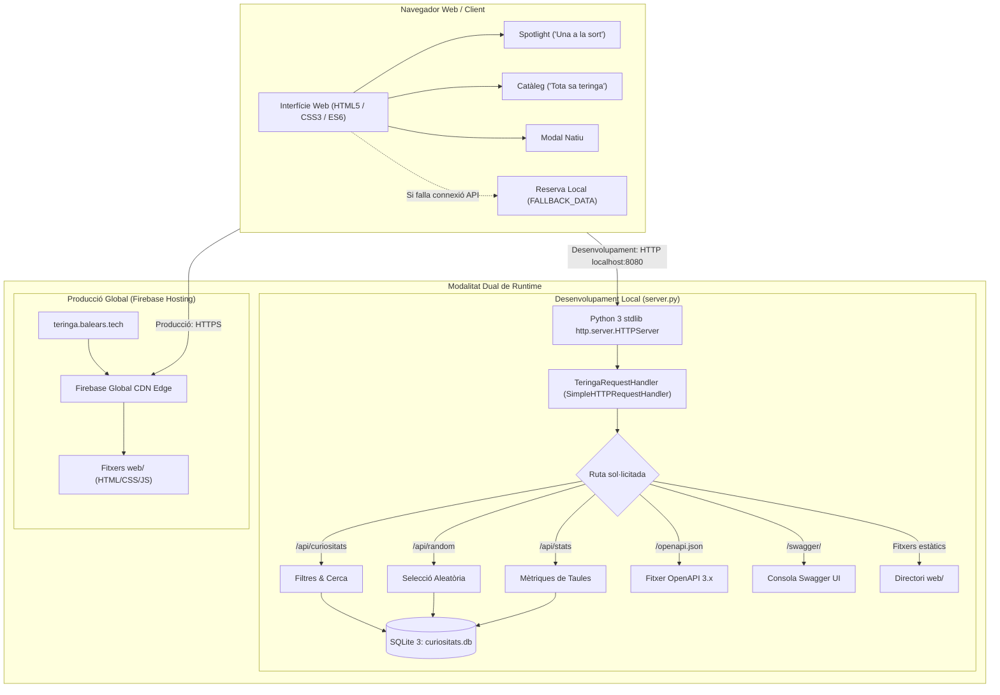
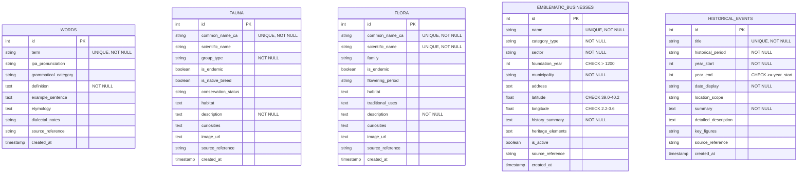

# Arquitectura Tècnica i Model de Dades

**Projecte**: «Una teringa de curiositats»  
**Versió de l'arquitectura**: 2.0 (Producció)  
**Entorns**: Desenvolupament local (Python stdlib HTTP Server & SQLite) i Producció (Firebase Global CDN SPA)

---

## 1. Visió General i Filosofia de Disseny

L'arquitectura d'**«Una teringa de curiositats»** ha estat dissenyada sota els principis de **màxima lleugeresa, zero dependències externes, portabilitat universal i alta resiliència**. 

El sistema evita intencionadament l'ús de frameworks o microframeworks pesants al backend (com Django o Flask, o llibreries externes) i al frontend (com React o Vue), per garantir que qualsevol persona pugui executar, inspeccionar i auditar el projecte amb una simple instal·lació estàndard de Python 3 i un navegador web modern, sense necessitat de compilar paquets, configurar entorns virtuals o descarregar centenars de megabytes de mòduls npm.

### Diagrama de l'Arquitectura Global



---

## 2. Capa Backend: Servidor Estàndard Python 3 (`server.py`)

A diferència de patrons convencionals basats en dependències externes, el backend de desenvolupament local s'implementa íntegrament mitjançant els mòduls nadius de Python 3: `http.server.HTTPServer`, `http.server.SimpleHTTPRequestHandler`, `sqlite3`, `urllib.parse` i `json`.

### 2.1. Nucli del Servidor (`http.server.HTTPServer`)
El fitxer `server.py` posa en marxa una instància de `http.server.HTTPServer` associada a la classe controladora `TeringaRequestHandler`, que hereta de `http.server.SimpleHTTPRequestHandler`.
* **Zero dependències externes**: Cap mòdul de tercers, facilitant l'arrencada immediata amb `python server.py`.
* **Arrel de documents estàtics**: Serveix el directori `web/` de forma nativa per a qualsevol petició d'actius (fitxers `.html`, `.css`, `.js`).
* **Interceptador de rutes API (`do_GET`)**: Reconeix els prefixos d'API abans de delegar a la resolució d'arxius estàtics.
* **Seguretat i capçaleres**:
  - `Content-Type: application/json; charset=utf-8`
  - `Access-Control-Allow-Origin: *` per permetre peticions asíncrones lliures des de qualsevol origen.

### 2.2. Gestió de Connexions SQLite
Cada consulta a l'API obre una connexió a la base de dades local `curiositats.db` mitjançant la funció `get_db_connection()`, establint `conn.row_factory = sqlite3.Row`. Això permet convertir cada fila retornada en un diccionari clau-valor amb noms de columnes idèntics als esperats pel model unificat del client.

---

## 3. Model de Dades Relacional i Base de Dades (SQLite 3)

La base de dades es troba a `curiositats.db`, gestionada mitjançant l'esquema relacional definit a `database/schema.sql`. Està dissenyada per ser totalment compatible tant amb **SQLite 3** com amb sistemes gestors relacionals com **PostgreSQL**.

### 3.1. Entitats i Taules Principals



### 3.2. Detall de Columnes, Restriccions i Índexs

#### 1. Taula `words` (Paraules, locucions i dites)
* **Finalitat**: Emmagatzema el patrimoni lèxic i fraseològic tradicional de Mallorca.
* **Camps claus**:
  - `term` (VARCHAR 150, UNIQUE, NOT NULL): Lema, expressió o dita mallorquina.
  - `ipa_pronunciation` (VARCHAR 100): Transcripció fonètica internacional segons el dialecte balear.
  - `grammatical_category` (VARCHAR 50): Categoria formal (p. ex: `nom femení`, `adjectiu`, `frase feta`, `dita popular`).
  - `definition` (TEXT, NOT NULL): Significat precís en català.
  - `example_sentence` (TEXT): Exemple històric o popular d'ús contextualitzat.
  - `etymology` (TEXT): Origen etimològic (llatí, àrab, mossàrab, romànic).
  - `dialectal_notes` (VARCHAR 150): Localització geogràfica insular (p. ex: `Pla de Mallorca`, `Sóller`, `Mallorquí general`).
  - `source_reference` (VARCHAR 255): Font autoritativa (p. ex: `DCVB (Alcover-Moll)`, `DIEC2`).
* **Índexs**: `idx_words_term` sobre `term`, `idx_words_category` sobre `grammatical_category`.

#### 2. Taula `fauna` (Espècies salvatges i races autòctones)
* **Finalitat**: Catalogació zoològica d'animals endèmics i races domèstiques balears reconegudes.
* **Camps claus**:
  - `common_name_ca` (VARCHAR 150, UNIQUE, NOT NULL): Denominació popular mallorquina.
  - `scientific_name` (VARCHAR 150): Nomenclatura binomial llatina.
  - `group_type` (VARCHAR 50, NOT NULL): Grup taxonòmic o zootècnic (`amfibi`, `reptil`, `au`, `mamifer`, `raça autòctona`).
  - `is_endemic` (BOOLEAN): Indica si és exclusiva de Mallorca o les Balears.
  - `is_native_breed` (BOOLEAN): Marca de reconeixement oficial per l'IRFAP com a raça autòctona.
  - `conservation_status` (VARCHAR 50): Categoria de protecció IUCN (`En perill crític (CR)`, `Vulnerable (VU)`, etc.).
  - `habitat` (TEXT), `description` (TEXT, NOT NULL), `curiosities` (TEXT), `image_url` (TEXT).
* **Índexs**: `idx_fauna_name` sobre `common_name_ca`, `idx_fauna_group` sobre `group_type`.

#### 3. Taula `flora` (Plantes i etnobotànica)
* **Finalitat**: Flora vascular autòctona, espècies rupícoles i usos tradicionals.
* **Camps claus**:
  - `common_name_ca` (VARCHAR 150, UNIQUE, NOT NULL): Nom popular mallorquí.
  - `scientific_name` (VARCHAR 150, UNIQUE, NOT NULL): Nom científic canònic.
  - `family` (VARCHAR 100): Família botànica.
  - `is_endemic` (BOOLEAN), `flowering_period` (VARCHAR 100), `habitat` (TEXT).
  - `traditional_uses` (TEXT): Usos etnobotànics (remeiers, gastronòmics, industrials).
  - `description` (TEXT, NOT NULL), `curiosities` (TEXT).
* **Índexs**: `idx_flora_name` sobre `common_name_ca`, `idx_flora_scientific` sobre `scientific_name`.

#### 4. Taula `emblematic_businesses` (Negocis i oficis emblemàtics)
* **Finalitat**: Comerços històrics, artesans i establiments catalogats d'interès patrimonial.
* **Camps claus**:
  - `name` (VARCHAR 200, UNIQUE, NOT NULL): Nom comercial o de l'establiment.
  - `category_type` (VARCHAR 100, NOT NULL): Classificació IDI (`Comerç arrelat`, `Comerç amb història`, `Comerç amb patrimoni`).
  - `sector` (VARCHAR 100, NOT NULL): Activitat (`Forn i Pastisseria`, `Artesania / Teixits`, `Restauració / Celler`).
  - `foundation_year` (INTEGER): Any d'obertura certificat.
  - `municipality` (VARCHAR 100, NOT NULL), `address` (TEXT).
  - `latitude` (REAL), `longitude` (REAL): Coordenades WGS84 per a geolocalització.
  - `history_summary` (TEXT, NOT NULL), `heritage_elements` (TEXT), `is_active` (BOOLEAN).
* **Restriccions CHECK**:
  - `CHECK (latitude BETWEEN 39.0 AND 40.2 AND longitude BETWEEN 2.2 AND 3.6)`: Limita estrictament la ubicació física a les coordenades reals de l'illa de Mallorca.
  - `CHECK (foundation_year IS NULL OR foundation_year > 1200)`: Assegura la coherència temporal del registre comercial.
* **Índexs**: `idx_businesses_municipality` sobre `municipality`, `idx_businesses_sector` sobre `sector`.

#### 5. Taula `historical_events` (Cronologia i fets històrics)
* **Finalitat**: Esdeveniments fonamentals de la història de Mallorca des de la prehistòria fins a l'actualitat.
* **Camps claus**:
  - `title` (VARCHAR 200, UNIQUE, NOT NULL): Denominació de l'episodi històric.
  - `historical_period` (VARCHAR 100, NOT NULL): Període (`Prehistòria i Talaiòtic`, `Època Romana`, `Època Islàmica (Mayûrqa)`, `Reialme de Mallorca`, `Edat Moderna`, `Edat Contemporània`).
  - `year_start` (INTEGER, NOT NULL), `year_end` (INTEGER).
  - `date_display` (VARCHAR 100, NOT NULL): Representació textual de la data per a visualització.
  - `location_scope` (VARCHAR 150), `summary` (TEXT, NOT NULL), `detailed_description` (TEXT), `key_figures` (TEXT).
* **Restriccions CHECK**:
  - `CHECK (year_end IS NULL OR year_start <= year_end)`: Evita inconsistències en rangs cronològics.
* **Índexs**: `idx_events_year` sobre `year_start`, `idx_events_period` sobre `historical_period`.

### 3.3. Protocol d'Inicialització i Verificació (`init_db.py`)
El procés d'ingesta implementa una arquitectura de doble barrera:
1. **Pre-comprovació**: El script valida l'estructura JSON a memòria abans d'obrir la connexió a la base de dades, assegurant que no hi hagi duplicats (`seen_set`), camps buits o valors fora de rang.
2. **Post-comprovació**: Després d'executar l'esquema i les insercions, realitza recomptes contra els totals esperats i executa consultes de comprovació d'integritat que dispararien una excepció en cas de trobar valors NULL indeguts.

---

## 4. Especificació de la REST API i Endpoints

L'API del servidor està dissenyada sota el principi d'**esquema unificat**: totes les entitats es projecten amb un conjunt de camps comú (`title`, `subtitle`, `tag`, `definition`, `source_reference`, `type`) perquè la interfície gràfica pugui pintar qualsevol curiositat sense conèixer els detalls interns de cada taula.

```text
┌─────────────────────────┬──────────────┬────────────────────────────────────────────────────────────┐
│ Endpoint                │ Mètode HTTP  │ Descripció                                                 │
├─────────────────────────┼──────────────┼────────────────────────────────────────────────────────────┤
│ /api/curiositats        │ GET          │ Retorna la llista unificada de curiositats amb filtres     │
│ /api/random             │ GET          │ Retorna un únic element seleccionat a l'atzar              │
│ /api/stats              │ GET          │ Retorna els totals per categories i total global           │
│ /openapi.json           │ GET          │ Retorna l'especificació completa OpenAPI 3.x (JSON)        │
│ /swagger/               │ GET          │ Serveix la consola interactiva Swagger UI                  │
└─────────────────────────┴──────────────┴────────────────────────────────────────────────────────────┘
```

### 4.1. `GET /api/curiositats`
Retorna una llista de curiositats en format JSON unificat.
* **Paràmetres de consulta (Query Parameters)**:
  - `category` (opcional, string): Filtra per un pilar concret. Valors permesos: `words`, `fauna`, `flora`, `businesses`, `history`.
  - `search` (opcional, string): Filtra per concordança de text lliure dins el títol, subtítol, etiqueta o definició. La cerca és insensible a majúscules/minúscules i tolera caràcters diacrítics catalans.
* **Exemple de petició**:
  ```http
  GET /api/curiositats?category=fauna&search=ferreret HTTP/1.1
  Host: localhost:8080
  ```
* **Exemple de resposta (200 OK)**:
  ```json
  [
    {
      "id": 1,
      "title": "Ferreret",
      "subtitle": "Alytes muletensis",
      "tag": "amfibi",
      "definition": "Petit gripau endèmic de Mallorca considerat un autèntic fòssil vivent...",
      "curiosities": "El mascle carrega els ous fecundats enganxats a les seves potes...",
      "is_endemic": 1,
      "is_native_breed": 0,
      "conservation_status": "Vulnerable (VU)",
      "habitat": "Gorgs de la Serra de Tramuntana",
      "source_reference": "Biodibal (UIB) / IRFAP",
      "type": "fauna"
    }
  ]
  ```

### 4.2. `GET /api/random`
Retorna un únic objecte JSON triat a l'atzar d'entre tots els elements del catàleg.
* **Paràmetres**: Cap.
* **Exemple de resposta (200 OK)**:
  ```json
  {
    "id": 3,
    "title": "Ullprès",
    "subtitle": "[uʎˈpɾəs]",
    "tag": "adjectiu",
    "definition": "Afectat pel mal d'ull segons la creença popular tradicional mallorquina...",
    "example_sentence": "El nin està tot ullprès d'ençà que va anar a la fira.",
    "etymology": "Compost de 'ull' i 'près' (presoner).",
    "dialectal_notes": "Mallorquí general",
    "source_reference": "Diccionari Català-Valencià-Balear (Alcover-Moll)",
    "type": "words"
  }
  ```

### 4.3. `GET /api/stats`
Retorna el recompte agregat de registres presents a la base de dades.
* **Paràmetres**: Cap.
* **Exemple de resposta (200 OK)**:
  ```json
  {
    "words": 8,
    "fauna": 7,
    "flora": 5,
    "businesses": 5,
    "history": 6,
    "total": 31
  }
  ```

### 4.4. `GET /openapi.json` i `GET /swagger/`
- `/openapi.json`: Serveix el document d'especificació d'OpenAPI 3.0 / 3.1 generat a `web/openapi.json`.
- `/swagger/`: Serveix una pàgina HTML independent (`web/swagger/index.html`) que inicialitza Swagger UI connectat directament amb `/openapi.json`, permetent provar interactivament cadascun dels endpoints des de qualsevol navegador.

---

## 5. Arquitectura del Frontend: Single-Page Application Nadiua

El frontend està construït seguint els estàndards més moderns de la plataforma web sense intermediació de transpiladors ni empaquetadors:

### 5.1. Pilars Tècnics del Frontend
1. **HTML5 Semàntic (`web/index.html`)**:
   - Etiquetes semàntiques (`<header>`, `<main>`, `<section>`, `<article>`, `<footer>`).
   - Finestra modal nativa `<dialog>` que garanteix la gestió correcta del focus del teclat (tecla Escape, tabulació circular) i lectors de pantalla sense necessitat de codi auxiliar.
2. **CSS3 Modular i Variables de Disseny (`web/style.css`)**:
   - Paleta de colors d'inspiració mediterrània (blau marí profund `#1A365D`, terracota `#C05621`, ocre daurat `#D69E2E`, verd pi `#2F855A`).
   - Tipografia de doble intenció: *Cinzel* (clàssica, monumental) per a encapçalaments i títols de marca, combinada amb *Plus Jakarta Sans* (geomètrica, neta) per a definicions i cos de text.
   - Suport natiu de preferències d'accessibilitat: `prefers-reduced-motion` desactiva automàticament les transicions d'impacte en dispositius d'usuaris que així ho requereixin.
3. **Controlador Client en JavaScript Pur (`web/app.js`)**:
   - Gestió d'estat reactiva local en memòria: `allItems`, `currentCategory`, `currentSearch`.
   - Cerca instantània en temps real amb cerca sobre el text complet unificat.
   - Commutació fluida entre la vista destacada **«Una a la sort»** i la vista de catàleg **«Tota sa teringa»**.

### 5.2. Mecanisme de Resiliència i Dades Offline (`FALLBACK_DATA`)
Per fer compatible l'aplicació tant amb entorns amb servidor dinàmic com amb entorns estàtics de distribució (CDN):
```javascript
async function loadData() {
  try {
    const res = await fetch("/api/curiositats");
    if (!res.ok) throw new Error("API not available");
    allItems = await res.json();
    if (!allItems || allItems.length === 0) {
      allItems = FALLBACK_DATA;
    }
  } catch (e) {
    // Si l'API no és accessible (Firebase Hosting, GitHub Pages, o file://),
    // s'activa automàticament el catàleg canònic integrat a FALLBACK_DATA.
    allItems = FALLBACK_DATA;
  }
}
```
Aquest disseny garanteix que l'experiència d'usuari a `https://teringa.balears.tech` sigui completament funcional fins i tot quan la infraestructura no disposa d'un procés de backend en execució contínua.

---

## 6. Pipeline d'Allotjament i Desplegament: Firebase Hosting

La infraestructura de distribució pública de producció s'executa a **Firebase Hosting** (Google Cloud Platform).

### 6.1. Configuració de Desplegament (`firebase.json`)
```json
{
  "hosting": {
    "public": "web",
    "ignore": [
      "firebase.json",
      "**/.*",
      "**/node_modules/**"
    ],
    "rewrites": [
      {
        "source": "**",
        "destination": "/index.html"
      }
    ]
  }
}
```
* **Directori arrel (`public: "web"`)**: Només els actius clients es publiquen a la xarxa CDN, mantenint fora de la distribució pública la base de dades crua, els scripts d'ingesta i el codi del servidor.
* **Reescriptures (`rewrites: "**" -> "/index.html"`)**: Permet l'enrutament transparent de la Single-Page Application des de qualsevol URL d'entrada.

### 6.2. Certificació SSL i Domini Personalitzat
* **Domini Oficial**: `https://teringa.balears.tech`
* **Dominis d'Àlies**: `https://teringa-curiositats.web.app` i `https://teringa-curiositats.firebaseapp.com`
* **Certificats**: Emissió i renovació automàtica de certificats Let's Encrypt / Google Trust Services gestionats pel proveïdor d'infraestructura CDN.
* **CDN Global**: Distribució de continguts en memòria cau als punts de presència (PoP) de Google a tot el món, aconseguint temps de càrrega inferiors a 150 ms des de qualsevol punt de les Illes Balears.
